<!--
  Bu profil kendi kendini günceller:
  - Başlık: .github/workflows/sky-banner.yml yarım saatte bir Çanakkale gökyüzünü çizer ("sky" dalı).
  - Günün arcade oyunu: .github/workflows/arcade.yml her gece katkı grafiğini başka bir oyuna çevirir ("output" dalı).
  - Dörtlü: .github/workflows/dortlu.yml issue ile gelen hamleleri oynar ve aşağıdaki DORTLU bölümünü yeniden yazar.
-->

  
  
  
  
  

Gerçek terminal portfolyomda: siteyi aç ve <kbd>/</kbd> tuşuna bas.

Bilgisayar Programcılığı okurken freelance olarak **canlıya çıkan** web siteleri ve masaüstü araçları geliştiriyorum. Bir işi uçtan uca alırım: veritabanı şeması, backend, admin paneli, arayüz, yayın ve güvenlik.

- **Şu an:** TEKYAZ IT v1.7, USB'den çalışan WPF / .NET 8 IT terminali
- **Öğreniyorum:** Next.js App Router, Three.js, Docker
- **Açığım:** freelance projeler ve staj

## Canlıdaki işler

| Site | Sektör |
| :-- | :-- |
| [efomat.com](https://efomat.com) | Matbaa, baskı |
| [matbaakent.com](https://matbaakent.com) | Matbaa, baskı |
| [bedirhanikincielspot.com](https://bedirhanikincielspot.com) | İkinci el ticaret |
| [canakkalesehitlik.com](https://canakkalesehitlik.com) | Turizm |
| [on7reklam.com](https://on7reklam.com) | Reklam ajansı |

Beşi de PHP ve MySQL ile geliştirildi. Şu an ayakta olup olmadıklarını [portfolyomda](https://eyupcalskanozturk-tr.github.io/#work) kendi tarayıcından ölçebilirsin.

## Öne çıkan projeler

**TEKYAZ IT** &nbsp;·&nbsp; WPF · .NET 8 · Google Apps Script &nbsp;·&nbsp; `v1.7` 
USB bellekten kurulumsuz çalışan, taşınabilir bir IT terminali. Dağınık duran 9 IT iş akışını tek uygulamada topluyor: envanter takibi, PDF rapor üretimi, Wi-Fi otomatik bağlantı, Google Sheets senkronu. Kurumsal iç kullanımda.

**[Portfolyo](https://eyupcalskanozturk-tr.github.io/)** &nbsp;·&nbsp; HTML · CSS · JavaScript &nbsp;·&nbsp; [kaynak](https://github.com/eyupcalskanozturk-tr/eyupcalskanozturk-tr.github.io) 
Rengini Çanakkale'nin canlı gökyüzünden alan kişisel site: tarayıcıda güneş konumu hesabı, imlece göre genişleyen değişken font harfleri, gizli Türkçe terminal. Framework ve bağımlılık yok.

**İdeal Hukuk Kulübü** &nbsp;·&nbsp; PHP · MySQL · Three.js &nbsp;·&nbsp; `geliştiriliyor` 
Üniversite hukuk kulübü için tanıtım sitesi. Three.js ile hareket eden bir adalet terazisi ve veritabanından beslenen duyurular.

**[Chen Atölyesi](https://eyupcalskanozturk-tr.github.io/chen-atolyesi/)** &nbsp;·&nbsp; Veri Tabanı I dersi için 
ER modelini ve Chen notasyonunu adım adım çözümlü örnek, alıştırmalar ve otomatik kontrol edilen diyagram kurmayla öğreten atölye.

**[IP2 Vize Kampı](https://eyupcalskanozturk-tr.github.io/laravel-vize/)** &nbsp;·&nbsp; İnternet Programcılığı II dersi için 
Laravel'i hafta hafta anlatan çalışma notu: HTTP, Composer, MVC, migration, Eloquent, doğrulama ve Blade; her haftanın sonunda cevaplı sorular.

**[okul-oncesi-oyunlar](https://github.com/eyupcalskanozturk-tr/okul-oncesi-oyunlar)** &nbsp;·&nbsp; HTML 
Okul öncesi için akıllı tahta oyunları: harf, ses, bellek ve çizgi takibi.

**[gold-password-generator](https://github.com/eyupcalskanozturk-tr/gold-password-generator)** &nbsp;·&nbsp; JavaScript · HTML/CSS 
Entropi tabanlı parola üretici: karakter havuzu seçimi, canlı güç göstergesi, tek tıkla kopyalama.

## Teknolojiler

<b>Katman katman</b>

 

| Katman | Kullandıklarım |
| :-- | :-- |
| Veritabanı | MySQL |
| Backend | PHP · Laravel · Node.js · C# |
| Arayüz | HTML · CSS · JavaScript · TypeScript · Next.js · React · Tailwind · Bootstrap · Three.js |
| Masaüstü | C# · WPF · .NET 8 |
| Yayın ve araçlar | Linux · Git · GitHub Actions · Netlify · Figma · VS Code · Visual Studio |

## Oyun köşesi

<h3 align="center">Günün arcade oyunu</h3>

  <a href="https://abozanona.github.io/pacman-contribution-graph/">
    <picture>
      <source media="(prefers-color-scheme: dark)" srcset="https://raw.githubusercontent.com/eyupcalskanozturk-tr/eyupcalskanozturk-tr/output/arcade-dark.svg">
      <source media="(prefers-color-scheme: light)" srcset="https://raw.githubusercontent.com/eyupcalskanozturk-tr/eyupcalskanozturk-tr/output/arcade.svg">
      
    </picture>
  </a>

Katkı grafiğim her gece başka bir oyuna dönüşüyor: Pac-Man, Breakout, Galaga, Puzzle Bobble, Bomberman ya da Mayın Tarlası. Bu oyun kendi kendine oynar, izlemelik. <b>Senin oynayabileceğin oyun hemen aşağıda: Dörtlü.</b>

<!-- DORTLU:START -->
<h3 align="center">Dörtlü: Eyüp'ün botunu yenebilir misin?</h3>

Aynı renkten <b>4 taşı</b> yan yana, alt alta ya da çapraz diz. <b>Tahtada bir sütuna tıkla</b>, açılan sayfada <b>Create</b>'e bas. Hamleni oynarım, bot hemen cevap verir; tahta birkaç saniye içinde burada güncellenir.

<b>Yeni oyun: ilk hamle senin, bir sütuna tıkla</b>

🔵 sen · 🟡 Eyüp'ün botu · oyun #1 · hamle 0

Ziyaretçiler <b>0</b> · Bot <b>0</b> · Berabere <b>0</b> Son hamleler: henüz yok, ilk hamle senin olsun!

<!-- DORTLU:END -->

<b>In English</b>

 

Full-stack developer based in Çanakkale, Türkiye. I build and ship production websites and desktop tools end to end: database schema, backend, admin panel, frontend, deployment and security. Five client sites are live (two print shops, a second-hand marketplace, a tourism site and an ad agency). I'm currently building **TEKYAZ IT**, a portable WPF / .NET 8 IT terminal that runs from a USB drive. Open to freelance work and internships: [portfolio](https://eyupcalskanozturk-tr.github.io/) · [email](mailto:eyupcalskanofficial@gmail.com).

There's a game on this profile too: play **Connect Four** against my bot by picking a column above.

<b>Bu profil nasıl çalışıyor?</b>

 

- **Gökyüzü başlığı:** [`scripts/sky-banner.mjs`](scripts/sky-banner.mjs), Çanakkale'de güneşin konumunu hesaplar (USNO yaklaşık formülü) ve ismimin harflerini o anın gökyüzüyle doldurur. Harfler, HarfBuzz ile dizilmiş Archivo glifleri olduğu için font yüklemeden çizilir. [Workflow](.github/workflows/sky-banner.yml) yarım saatte bir çalışır.
- **Terminal ve logo şeridi:** [`scripts/terminal.mjs`](scripts/terminal.mjs) ve [`scripts/stack.mjs`](scripts/stack.mjs) ile üretilen animasyonlu SVG'ler. Logolar [simple-icons](https://simpleicons.org) (CC0).
- **Günün arcade oyunu:** [pacman-contribution-graph](https://github.com/abozanona/pacman-contribution-graph) katkı grafiğimi oyuna çevirir. [Workflow](.github/workflows/arcade.yml) onu sabit bir sürümle ve yalnızca okuma izniyle çalıştırır.
- **Dörtlü:** Tahta 7 ayrı sütun görselinden oluşur; her sütun kendi hamle linkine sarılıdır. Bir sütuna tıklayınca açılan issue'yu [workflow](.github/workflows/dortlu.yml) işler. [`game/dortlu.mjs`](game/dortlu.mjs) hamleni oynar, bot alfa-beta budamalı minimax ile cevap verir, tahtayı yeniden çizer ve issue'yu kapatır.

---

Bir proje ya da staj fırsatı için: <a href="mailto:eyupcalskanofficial@gmail.com"><b>eyupcalskanofficial@gmail.com</b></a>

